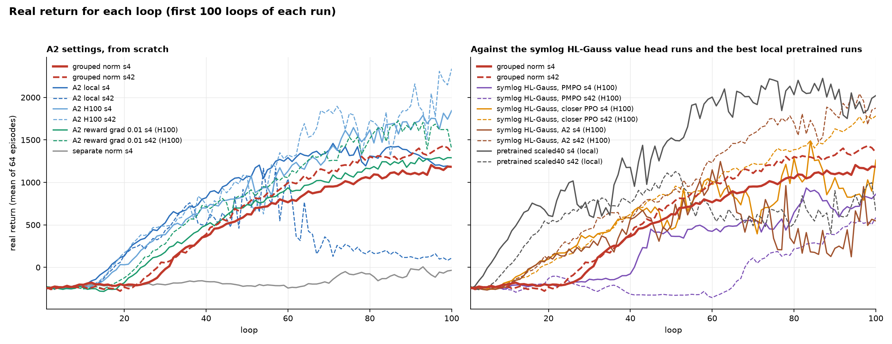
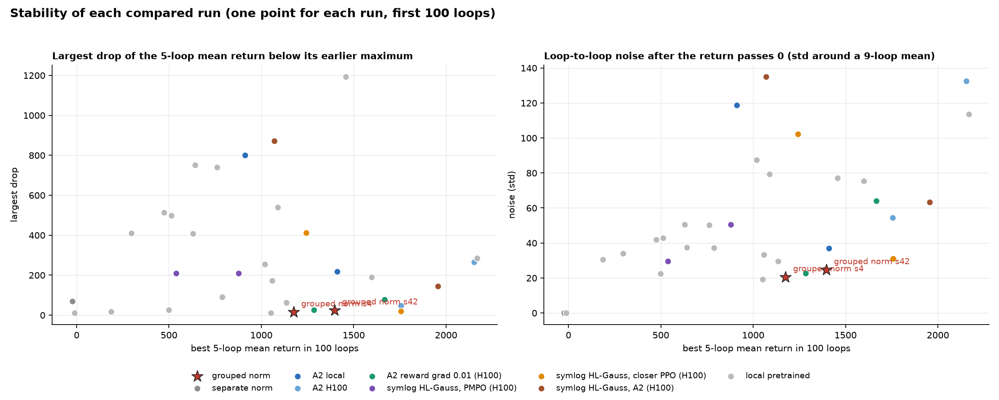
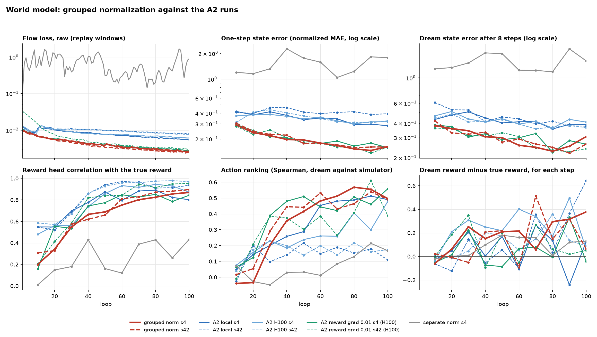
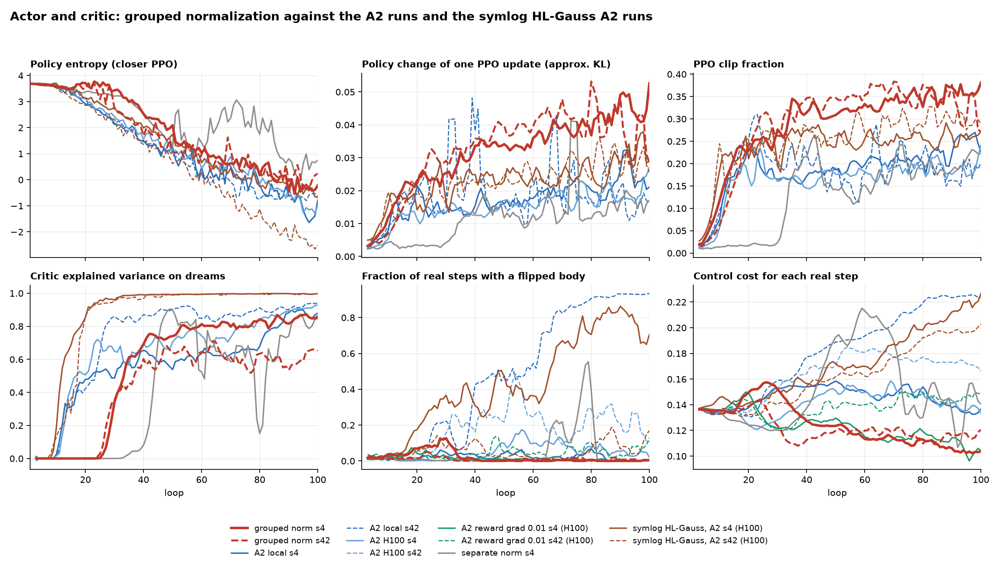

# Grouped loss normalization on the A2 settings: log analysis

Date: 2026-10-01. Run: `a2_grouped_loss_normalization_s4` (entry 73, queue 10-1-26c).

## 1. Summary

- The run learns. Its return is 1,170 at loops 95-99, and the largest drop of its 5-loop mean return is 15.
- The run is the most stable A2 run of seed 4, but it starts late: its return passes 0 at loop 32. The plain A2 runs pass 0 at loops 18 to 20.
- The cause of the late start is the reward model, not the actor. The reward head gives the mean reward for the first 25 loops, so dreams give no signal to the critic and the actor.
- The run has the same profile as the earlier H100 run `a2_reduced_reward_transformer_gradient2` (reward gradient into the transformer times 0.01). Both give the transformer to the dynamics loss. Both get about half the dynamics error, a late start, and a smooth return curve.
- The control run with separate statistics (`a2_loss_normalization_s4`) fails as the August runs did: its flow loss goes to 0.3 to 1.0 and its return stays below 0. Thus the group of flow and bootstrap is the necessary part.
- The first recommendation for more speed is more weight for the reward term under normalization (section 7).
- Seed 42 (`a2_grouped_loss_normalization_s42`) gives the same result: return 1,396 at loops 95-99, largest drop 24, late start at loop 30 (section 9). The plain A2 local run of seed 42 fell to 112.

## 2. Runs and method

`a2_grouped_loss_normalization_s4` is the local A2 run (`audit_a2_next_state_reward_target_local_s4`) with two more settings: `use_dynamics_loss_normalization` and `group_dynamics_loss_normalization`. The statistics are live. It has 100 loops (6.4 M environment steps) and took 0.63 hours with a second run on the GPU.

The compared runs, all at their first 100 loops:

| Group | Runs | Machine |
| --- | --- | --- |
| A2 local | `audit_a2_next_state_reward_target_local_s4`, `_s42` | local |
| A2 H100 | `audit_a2_next_state_reward_target2` (seed 4), `audit_a2_next_state_reward_target` (seed 42) | H100 |
| A2 reward grad 0.01 | `a2_reduced_reward_transformer_gradient2` (seed 4), `a2_reduced_reward_transformer_gradient` (seed 42) | H100 |
| Separate norm | `a2_loss_normalization_s4` (entry 74) | local |
| Symlog HL-Gauss value head, PMPO | `symlog_hl_gauss_value_head2` (seed 4), `symlog_hl_gauss_value_head` (seed 42) | H100 |
| Symlog HL-Gauss value head, closer PPO | `closer_ppo_symlog_hl_gauss_value_head2`, `closer_ppo_symlog_hl_gauss_value_head` | H100 |
| Symlog HL-Gauss value head, A2 | `closer_ppo_next_state_reward_symlog_value_head2`, `closer_ppo_next_state_reward_symlog_value_head` | H100 |
| Local pretrained | 18 local runs that start from an offline pretrain | local |

`scripts/extract.py` reads the TensorBoard logs and writes one value for each loop and tag. `scripts/plot.py` draws the figures. The stability numbers use the mean real return of each loop:

- **Largest drop:** the largest fall of the 5-loop mean below its earlier maximum.
- **Noise:** the standard deviation of the return around a 9-loop mean, after the return passes 0.
- **Loop at 0, 500, 1,000:** the first loop where the 5-loop mean reaches that return.

## 3. Return, speed, and stability

Seed 4 runs:

| Run | Return, loops 95-99 | Best 5-loop mean | Loop at 0 | Loop at 500 | Loop at 1,000 | Largest drop | Noise | Loops with a drop over 200 |
| --- | --- | --- | --- | --- | --- | --- | --- | --- |
| **grouped norm s4** | 1,170 | 1,174 | 32 | 46 | 77 | 15 | 21 | 0 |
| A2 local s4 | 1,194 | 1,411 | 18 | 31 | 47 | 217 | 37 | 0 |
| A2 H100 s4 | 1,755 | 1,755 | 20 | 34 | 58 | 47 | 54 | 0 |
| A2 reward grad 0.01 s4 | 1,285 | 1,285 | 26 | 42 | 68 | 25 | 23 | 0 |
| separate norm s4 | −64 | −23 | none | none | none | 69 | 0 | 0 |
| symlog PMPO s4 | 811 | 878 | 42 | 67 | none | 209 | 51 | 0 |
| symlog closer PPO s4 | 968 | 1,243 | 17 | 38 | 79 | 413 | 102 | 7 |
| symlog A2 s4 | 619 | 1,069 | 18 | 41 | 61 | 872 | 135 | 9 |
| pretrained scaled40 s4 | 1,925 | 2,168 | 7 | 14 | 38 | 286 | 114 | 7 |

Seed 42 runs of the same settings:

| Run | Return, loops 95-99 | Best 5-loop mean | Loop at 500 | Largest drop | Noise |
| --- | --- | --- | --- | --- | --- |
| **grouped norm s42** | 1,396 | 1,396 | 44 | 24 | 25 |
| A2 local s42 | 112 | 912 | 33 | 800 | 119 |
| A2 H100 s42 | 2,153 | 2,153 | 32 | 266 | 133 |
| A2 reward grad 0.01 s42 | 1,589 | 1,666 | 36 | 77 | 64 |
| symlog PMPO s42 | 538 | 538 | 95 | 209 | 30 |
| symlog closer PPO s42 | 1,756 | 1,756 | 38 | 19 | 31 |
| symlog A2 s42 | 1,881 | 1,955 | 32 | 146 | 63 |
| pretrained scaled40 s42 | 851 | 1,089 | 21 | 541 | 79 |

- 19 of the 33 compared runs reach 1,000. Of these, the two grouped runs have the second and fourth lowest largest drop (15 and 24) and the second and fourth lowest noise (21 and 25).
- It is 14 to 15 loops later than A2 local s4 at the thresholds 0 and 500, and 30 loops later at 1,000.
- After the return passes 0, its slope is 14.5 return for each loop. A2 local s4 has 13.4, A2 H100 s4 has 21.6.
- Its growth slows near the end: the 10-loop means rise by 140, 90, and 50 in the last three blocks.
- The plain A2 settings give very different results with a second seed (A2 local: 1,194 and 112). The grouped settings give 1,170 and 1,396 (section 9).

## 4. World model

Means over 10 loops, seed 4:

| Metric | Loops | grouped norm | A2 local | A2 H100 | reward grad 0.01 | separate norm |
| --- | --- | --- | --- | --- | --- | --- |
| Flow loss, raw | 0-9 | 0.0081 | 0.0099 | 0.0104 | 0.0085 | 0.71 |
| Flow loss, raw | 90-99 | 0.0027 | 0.0056 | 0.0063 | 0.0029 | 0.89 |
| Bootstrap loss, raw | 90-99 | 0.00021 | 0.00053 | 0.00057 | 0.00022 | 0.00038 |
| One-step state error | 90-99 | 0.16 | 0.29 | 0.32 | 0.16 | 1.78 |
| Dream state error, 1 step | 90-99 | 0.13 | 0.27 | 0.25 | 0.15 | 1.43 |
| Dream state error, 8 steps | 90-99 | 0.31 | 0.39 | 0.41 | 0.26 | 1.41 |
| One-step x-velocity error | 90-99 | 0.09 | 0.14 | 0.18 | 0.13 | 0.62 |
| Reward error on replay (MAE) | 20-29 | 0.439 | 0.391 | 0.390 | 0.418 | 0.433 |
| Reward error on replay (MAE) | 90-99 | 0.357 | 0.289 | 0.306 | 0.363 | 0.329 |
| Reward head correlation | 0-9 | 0.20 | 0.55 | 0.48 | 0.16 | 0.01 |
| Reward head correlation | 90-99 | 0.87 | 0.80 | 0.87 | 0.84 | 0.43 |
| Action ranking (Spearman) | 0-19 | −0.04 | 0.10 | 0.12 | 0.09 | 0.02 |
| Action ranking (Spearman) | 90-99 | 0.50 | 0.49 | 0.48 | 0.56 | 0.17 |
| Transformer gradient norm | 90-99 | 10.6 | 5.7 | 4.5 | 0.06 | 62 |
| Tokenizer error on policy states | 90-99 | 0.00016 | 0.00022 | 0.00033 | 0.00019 | 0.00015 |

- **Dynamics.** The grouped run has about half the flow loss and half the state error of the plain A2 runs. Its numbers agree with the reward grad 0.01 run to two digits.
- **Reward.** The reward model is the weak part. Its error on replay stays at 0.446 (the error of a constant output) for 25 loops, and it stays above the plain A2 runs for the full run.
- **Statistics.** The checkpoints give these running RMS values: flow plus bootstrap 0.0042 (loop 50) and 0.0029 (loop 100), reward 2.5 to 2.7 for each of the 8 distances. Thus the multipliers are about 240 to 350 for the dynamics and 0.38 for the reward.
- **Gradient share.** With the reward gradient times 0.01, the transformer gradient norm is 0.06 to 0.10, so the dynamics part of a plain A2 run is about 2 % of its total of 4 to 6. In the grouped run the total is 11, and the reward part is about 0.38 × 4 to 6. This is an estimate from logged norms: the reward moves from about 98 % of the transformer gradient to about 15 to 20 %.
- **Terminal terms.** The agent terminal statistic falls to 5e-18 (the loss is 0, HalfCheetah has no terminals). The term has no effect now, but the statistic is meaningless.

## 5. Actor

Means over 10 loops, seed 4:

| Metric | Loops | grouped norm | A2 local | A2 H100 | symlog A2 (H100) |
| --- | --- | --- | --- | --- | --- |
| Policy entropy | 10-19 | 3.58 | 3.25 | 3.35 | 3.38 |
| Policy entropy | 20-29 | 3.60 | 2.57 | 2.69 | 2.90 |
| Policy entropy | 90-99 | −0.28 | −1.08 | −0.96 | −0.43 |
| KL of one PPO update | 40-49 | 0.034 | 0.016 | 0.014 | 0.023 |
| KL of one PPO update | 90-99 | 0.046 | 0.025 | 0.020 | 0.032 |
| PPO clip fraction | 90-99 | 0.37 | 0.25 | 0.20 | 0.26 |
| Action saturation in real steps | 90-99 | 0.014 | 0.013 | 0.013 | 0.115 |
| Control cost for each real step | 90-99 | 0.103 | 0.135 | 0.136 | 0.220 |
| Flipped fraction of real steps | 40-99 | 0.002 | 0.021 | 0.074 | 0.59 |
| Forward velocity (m/s) | 90-99 | 1.25 | 1.38 | 1.88 | 0.70 |

- The entropy does not move until loop 30. The actor has no signal before that loop (section 6).
- After loop 30, each PPO update changes the policy about two times more than in the plain A2 runs (KL 0.034 to 0.046, clip fraction 0.31 to 0.37). The return curve is still smoother.
- The gait uses less control (cost 0.10 against 0.135) and has almost no flipped steps after loop 40. It is also slower: 1.25 m/s.
- A small flip phase occurs at loops 25 to 33 (flipped fraction up to 0.2) and ends without a collapse.

## 6. Critic and dreams

| Metric | Loops | grouped norm | A2 local | A2 H100 | symlog A2 (H100) |
| --- | --- | --- | --- | --- | --- |
| Explained variance | 10-19 | 0.000 | 0.38 | 0.42 | 0.75 |
| Explained variance | 20-29 | 0.12 | 0.52 | 0.67 | 0.95 |
| Explained variance | 40-49 | 0.74 | 0.58 | 0.70 | 0.99 |
| Explained variance | 90-99 | 0.86 | 0.88 | 0.91 | 0.995 |
| Value squared error | 90-99 | 50 | 38 | no log | no log |
| Dream return (32 steps) | 20-29 | −4.1 | 8.2 | no log | no log |
| Dream return (32 steps) | 90-99 | 30.7 | 33.9 | no log | no log |
| Correlation of dream and true return | 0-19 | 0.01 | 0.36 | 0.37 | 0.52 |
| Correlation of dream and true return | 80-99 | 0.89 | 0.72 | 0.80 | 0.91 |
| Dream reward minus true reward, each step | 80-99 | +0.35 | −0.06 | +0.28 | no log |
| Dreams above the true return (fraction) | 80-99 | 0.98 | 0.39 | 0.76 | no log |

- **Critic.** The explained variance is 0 for 25 loops, because the dream rewards have no spread. From loop 40, it is at or above the plain A2 runs.
- **Symlog HL-Gauss value head.** Those runs have a much better critic (explained variance 0.99). They are not more stable: symlog A2 s4 falls by 872 and flips in 59 % of its steps. A good critic alone does not give stability in these runs.
- **Dream optimism.** At loops 80 to 99, 98 % of the dreams give more reward than the simulator from the same start, by 0.35 for each step (true reward 0.68). The dream state error is low, so the reward head is the probable source. This grows when the return growth slows.

## 7. How to make the return rise faster

### Cause of the slow start

The delay is in the reward model:

1. The reward error on replay stays at the constant-output level (0.446) until loop 25. In the plain A2 runs it leaves that level at loop 10.
2. The reward head correlation at loops 0 to 9 is 0.20 (plain A2: 0.48 to 0.55).
3. The dreams thus give no reward spread: critic explained variance 0, correlation of dream and true return 0.01, action ranking −0.04.
4. The actor entropy stays at 3.6 until loop 30. The return passes 0 at loop 32.

The run with the reward gradient times 0.01 has the same sequence (reward error flat until loop 20, return passes 0 at loop 26). In both runs the transformer gets little reward gradient, so it builds reward features late. The normalization does this through the scale of the reward loss: the HL-Gauss reward target has an entropy of 2.11 nats, so a reward loss of 2.6 to 2.8 has a learnable part of only 0.5 to 0.7. The RMS of the full loss gives a multiplier of 0.38.

### Options

| Rank | Change | Evidence | Cost and risk |
| --- | --- | --- | --- |
| 1 | More weight for the reward term under normalization. Either normalize the learnable part of the reward loss (loss minus the target entropy, multiplier about 1.5 to 2), or add a fixed reward weight of about 4. | The two runs with a weak reward gradient start 8 to 14 loops late. The dream optimism at the end also points to the reward head. | A new flag. A strong reward gradient goes with worse dynamics and larger drops in the plain A2 runs, so test two weights. |
| 2 | Start from the pretrained world model (`a2_scaled40_s4`). | Pretrained runs reach 500 at loops 14 to 21. Their weakness is drops and flips, which is the strength of this run. | The pretrain must have the same normalization settings, or the loader must accept the missing statistic. |
| 3 | Plain sum for the first 10 to 15 loops, then normalization. | The plain sum gives the reward features fast. The normalization gives the dynamics accuracy later. | A new flag. The switch changes the loss scale in one step. |
| 4 | More world-model steps before loop 0 (256 to about 600). | The reward head left the constant level after about 580 world-model steps. | About 4 minutes of compute. The first data is from a random policy, so the gain is not sure. |
| 5 | Run 200 loops. | The return still rises at loop 100, and the plain A2 local run falls after loop 85. | About 40 minutes. This shows the final level, not a faster start. |

Not recommended: a higher PPO learning rate or more PPO epochs. The policy change for each update is already two times that of the plain A2 runs.

## 8. Stability against other runs

- **A2 runs of seed 4.** Largest drop 15 against 217 (local) and 47 (H100). Noise 21 against 37 and 54. Flipped fraction 0.002 against 0.02 and 0.07.
- **A2 runs of seed 42.** Largest drop 24 against 800 (local) and 266 (H100). Noise 25 against 119 and 133. Flipped fraction at loops 90-99: 0.006 against 0.93 and 0.17.
- **Same profile.** The reward grad 0.01 run of seed 4 is as stable (largest drop 25, noise 23). Its seed 42 run is less stable (largest drop 77, 3 loops with a drop over 200).
- **Symlog HL-Gauss value head.** 4 of the 6 runs have a largest drop above 200, and 2 have more than 6 loops with a drop over 200. The grouped run is more stable than each of the three seed-4 runs. The seed 42 closer PPO run is as stable (largest drop 19) at a higher return (1,756).
- **Local pretrained runs.** 10 of 18 have a largest drop above 200, and 11 of 18 have a flipped fraction above 0.5 in some loop. Four have a largest drop below 30, at best returns of −12 to 1,050.
- **Probable reason.** The dynamics error is half, the dream agrees with the simulator (return correlation 0.89), and the policy stays slow and upright. Many collapses in the other runs go through a flipped gait.
- **Limit of the claim.** The run reaches only 1.25 m/s. Other runs have their drops at returns of 900 to 1,500, and this run is in that range only for its last 25 loops.

## 9. Second seed

`a2_grouped_loss_normalization_s42` (entry 77, queue 10-1-26e) ran alone on the GPU on 2026-10-01 (100 loops, 23 minutes, exit 0). All figures include it as the dashed red line.

| Measure | grouped s4 | grouped s42 | A2 local s42 | A2 H100 s42 | reward grad 0.01 s42 |
| --- | --- | --- | --- | --- | --- |
| Return, loops 95-99 | 1,170 | 1,396 | 112 | 2,153 | 1,589 |
| Best 5-loop mean | 1,174 | 1,396 | 912 | 2,153 | 1,666 |
| Loop at 0 / 500 / 1,000 | 32 / 46 / 77 | 30 / 44 / 63 | 19 / 33 / none | 18 / 32 / 49 | 24 / 36 / 58 |
| Largest drop | 15 | 24 | 800 | 266 | 77 |
| Noise | 21 | 25 | 119 | 133 | 64 |
| Loops with a drop over 200 | 0 | 0 | 8 | 8 | 3 |
| Largest flipped fraction in one loop | 0.20 | 0.07 | 0.94 | 0.54 | 0.26 |
| Flow loss, raw, loops 90-99 | 0.0027 | 0.0025 | 0.0081 | 0.0077 | 0.0031 |
| One-step state error, loops 90-99 | 0.16 | 0.16 | 0.39 | 0.33 | 0.16 |
| First loop with a reward error on replay below 0.43 | 27 | 25 | 10 | 10 | 31 |
| Critic explained variance, loops 90-99 | 0.86 | 0.63 | 0.93 | not logged | not logged |
| Dream reward minus true reward, loops 89 and 99 | +0.35 | +0.19 | +0.50 | +0.11 | +0.04 |
| Slope after the return passes 0 (return for each loop) | 14.5 | 18.6 | −5.6 | 23.8 | 20.5 |

- **The result repeats.** Seed 42 has the same late start (loop 30 against 32), the same dynamics quality, and the same smooth curve (largest drop 24, no loop with a drop over 200).
- **The stability claim now has a controlled pair on seed 42.** The plain A2 local run of seed 42 went to a flipped gait (flipped fraction 0.93 at loops 90-99) and fell from 912 to 112. The grouped run stayed upright (0.006) and did not fall.
- **The return is higher and still rises.** The 10-loop means of the last three blocks are 1,222, 1,296, and 1,375. The best 5-loop mean is the last one.
- **The slow start has the same cause.** The reward error goes below 0.43 at loop 25 (plain A2: loop 10), and the critic explained variance passes 0.1 at loop 25.
- **The critic is weaker in seed 42** (explained variance 0.58 to 0.65 after loop 40), and the return is still higher. This agrees with section 8: critic accuracy is not the source of stability.
- **Cost of the method.** Both grouped seeds are below the H100 runs of the same seed at loop 100 (1,170 against 1,755; 1,396 against 2,153) and below the reward grad 0.01 runs (1,285 and 1,589).

## 10. Limits

- Two seeds for the grouped run, one seed for the separate-statistics control. Seed noise in this setup is about ±1,000 return at loop 100.
- The H100 runs differ from local runs in rounding settings (micro-batch, bf16, einsum attention pools) and in the code date.
- The gradient share in section 4 is an estimate from logged norms. No gradient probe was run.
- The causes in section 7 come from the order of events in the logs and from one similar run. No controlled test of the options exists.
- All compiled runs have the wrong first dream frame (the compiled short-sequence bug). It applies to all compared runs in the same way.

## 11. Files

- `data/loop_metrics.csv`: one value for each run, loop, and tag.
- `data/episodes.csv`: mean, standard deviation, 10th percentile, and minimum of the 64 real episodes of each loop.
- `data/run_summary.csv`: the return, speed, and stability numbers of each run.
- `figures/`: `returns.png`, `world_model.png`, `actor_critic.png`, `stability.png`.
- `scripts/extract.py`, `scripts/plot.py`.
