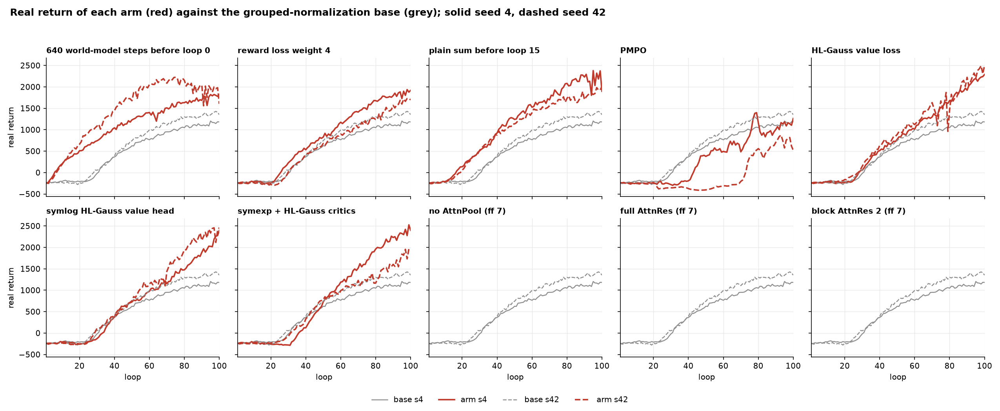
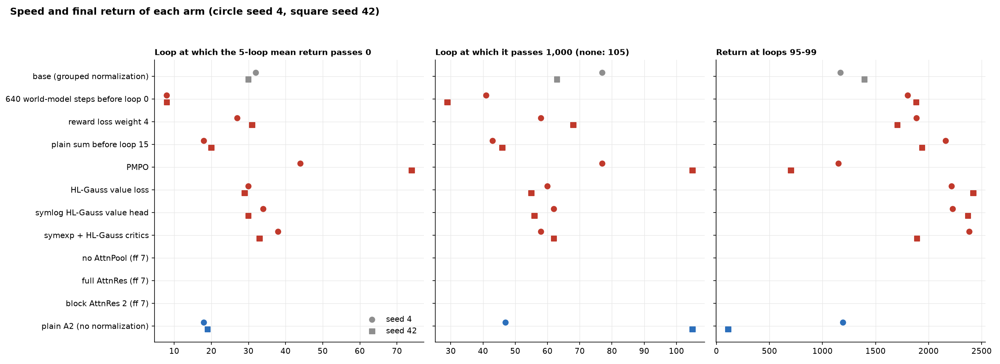
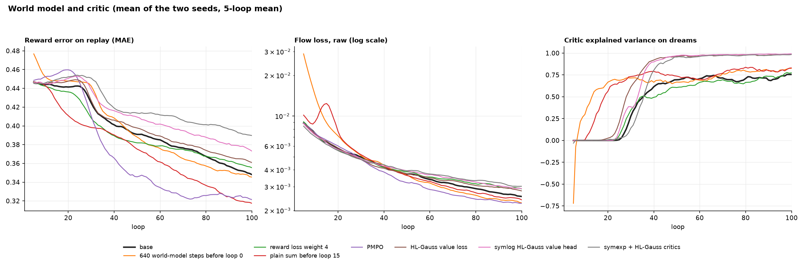

# One-change ablations of the grouped loss normalization run

Date: 2026-10-03. Queue: `scripts/queue_10-2-26.sh`, record `runs/queues/10-2-26_2026-10-02_225417`. Entries 78-97 of `train/ablations.py`.

## 1. Summary

- 14 of the 20 runs are complete. The 6 attention runs (entries 92-97) wait for free space on /data (section 7).
- All 7 completed arms, except PMPO, end above the base on both seeds.
- **The largest gain comes from the value loss.** A cross-entropy (HL-Gauss) value loss in place of MSE gives a return of 1,891 to 2,422 at loops 95-99. The base gives 1,170 and 1,396. The three value arms have a critic explained variance of 0.98; the base has 0.72.
- **The three speed arms do what section 7 of `report/10-1-26-grouped-normalization` predicted.**
  - 640 world-model steps before loop 0: the return passes 0 at loop 8 (base: 30-32).
  - The plain sum before loop 15: the return passes 0 at loops 18-20, the same loop as plain A2.
  - Reward loss weight 4: the start does not change (loops 27 and 31), but the return at loop 100 is higher (1,887 and 1,706), and the runs stay stable.
- **PMPO is the only arm below the base.** It starts at loops 44 and 74, and it ends at 1,151 and 702.
- The value arms and the speed arms change different phases: the speed arms change the start, and the value arms change the slope after the start. A combination of the two is the first recommendation (section 6).

## 2. Runs and method

Each arm is entry 73 (`a2_grouped_loss_normalization_s4`) or entry 77 (`_s42`) with one change. Both seeds ran for each arm. All runs are 100 loops on the local GPU, two at a time, with the same settings as the base runs.

| Arm | Change | Entries |
| --- | --- | --- |
| `wm_pretrain640` | `pretrain_world_model_combined_steps` 640 (base 256) | 78, 79 |
| `reward_weight4` | `world_model_reward_loss_weight` 4 (new flag) | 80, 81 |
| `norm_warmup15` | `dynamics_loss_normalization_start_loop` 15 (new flag): plain loss sum before loop 15, the RMS statistics update from the start | 82, 83 |
| `pmpo` | PMPO with the config defaults (prior KL 0.3, learning rate 6e-4) in place of closer PPO | 84, 85 |
| `hl_gauss_value_loss` | the base value head (raw HL-Gauss, range ±1,200) with the HL-Gauss cross-entropy loss in place of MSE | 86, 87 |
| `symlog_hl_gauss_value_head` | the symlog HL-Gauss value head and its cross-entropy loss (as `closer_ppo_symlog_hl_gauss_value_head`) | 88, 89 |
| `symexp_hl_gauss_actor_critic` | a symexp two-hot value head beside a raw HL-Gauss critic that gives GAE (as `symexp_hl_gauss_actor_critic`), both with cross-entropy losses | 90, 91 |
| `no_attn_pool` | no AttnPool, feedforward expansion 7 (equal transformer parameters) | 92, 93 (waits) |
| `full_attn_res` | full AttnRes, feedforward expansion 7 | 94, 95 (waits) |
| `block2_attn_res` | block AttnRes with 2 sublayers for each block, feedforward expansion 7 | 96, 97 (waits) |

The measures are the same as in `report/10-1-26-grouped-normalization` (its `extract.py` reads the logs). "Loop at 0" is the last loop of the first 5-loop window with a mean return of 0 or more. "Largest drop" is the largest fall of the 5-loop mean below its earlier maximum.

Code checks before the queue: the default path gives the same checkpoints bit for bit as the base tree; the unit tests pass; all arms ran 2 loops on the CPU; a compiled GPU run of the warmup arm showed the plain sum before the switch loop and normalization after it; an adversarial review found no blocking issue (two smaller issues were fixed).

## 3. Results

| Arm | Return, loops 95-99 (s4 / s42) | Loop at 0 | Loop at 1,000 | Largest drop | Slope after 0 (return for each loop) |
| --- | --- | --- | --- | --- | --- |
| base | 1,170 / 1,396 | 32 / 30 | 77 / 63 | 15 / 24 | 14 / 19 |
| `wm_pretrain640` | 1,804 / 1,884 | **8 / 8** | 41 / **29** | 57 / 337 | 17 / 19 |
| `reward_weight4` | 1,887 / 1,706 | 27 / 31 | 58 / 68 | 35 / 50 | 25 / 23 |
| `norm_warmup15` | 2,162 / 1,939 | 18 / 20 | 43 / 46 | 148 / 50 | 27 / 21 |
| `pmpo` | 1,151 / 702 | 44 / 74 | 77 / none | 340 / 170 | 17 / 15 |
| `hl_gauss_value_loss` | 2,218 / **2,422** | 30 / 29 | 60 / 55 | 15 / 138 | 30 / 30 |
| `symlog_hl_gauss_value_head` | 2,228 / 2,372 | 34 / 30 | 62 / 56 | 43 / 30 | 30 / 36 |
| `symexp_hl_gauss_actor_critic` | **2,385** / 1,891 | 38 / 33 | 58 / 62 | 62 / 37 | 38 / 24 |
| plain A2 (no normalization, reference) | 1,194 / 112 | 18 / 19 | 47 / none | 217 / 800 | 13 / −6 |

## 4. Findings for each arm

### Speed arms

- **640 world-model steps before loop 0.** The reward model leaves the mean reward before loop 0, so the critic and the actor get a signal from the first loop. The return passes 0 at loop 8, which is 10 loops earlier than plain A2 and 22 loops earlier than the base. The seed 42 run reaches 2,200 at loop 75, then falls by 337 to 1,884. The cost is 384 more world-model steps at loop 0 (a few minutes).
- **Plain sum before loop 15.** The reward error falls from about loop 8 (base: from loop 25), because the plain sum gives the reward term most of the gradient. During the plain sum the raw flow loss rises to about 0.012 at loop 15. After the switch it falls to the base level by loop 25. After loop 40 the reward error is the lowest of all arms (0.32 at loops 90-99, base 0.35). The seed 4 run has 3 loops with a drop over 200 after loop 90.
- **Reward loss weight 4.** The start does not change (loops 27 and 31 against 32 and 30). The slope after the start rises from 14-19 to 23-25, and the runs stay smooth (largest drop 35 and 50). The weight gives the reward head more gradient in all loops, not only at the start.

### Objective

- **PMPO** is slow on both seeds. Seed 42 stays below −300 until loop 70. This agrees with the H100 PMPO runs of the symlog value head (return passes 0 at loops 42 and 70). The PMPO dreams have the lowest reward gap (+0.002 for each step) but the lowest correlation of dream and true return (0.58 at loops 70-99). Closer PPO stays the better objective on these settings.

### Value head and value loss

- All three arms with a cross-entropy value loss reach a critic explained variance of 0.98 at loops 80-99 (base 0.72). The mean absolute value error falls from 6.9 to 1.4-1.9.
- The return rises at 24 to 38 for each loop after the start, about two times the base slope. The start loop does not change (29 to 38). Thus the critic limits the late growth of the base, and the reward model limits its start.
- The policy entropy falls further (−0.55 to −0.99 against +0.04) and each PPO update changes the policy a little more (approx. KL 0.050 against 0.041). The velocity at loops 90-99 is 2.25 to 2.43 m/s (base 1.37).
- The world-model measures are a little worse late in the run (reward error 0.36-0.39 against 0.35, action ranking 0.28-0.38 against 0.52). The policy moves to faster states, where the model has less data. The real return still rises.
- Stability stays near the base, with two exceptions on seed 42. `hl_gauss_value_loss` has one loop with a drop of 906 at loop 79 and recovers in 2 loops. `symlog_hl_gauss_value_head` has one loop with a drop of 340. No run goes to a flipped gait (largest flipped fraction 0.38 in one loop, 0.043 or less at loops 90-99).
- The three heads do not differ clearly with two seeds. The raw HL-Gauss head with its cross-entropy loss is the smallest change.
- In `symexp_hl_gauss_actor_critic`, the explained variance measures the HL-Gauss critic that gives GAE. The `critic/value_*` tags measure the symexp head.

## 5. Stability

- No completed arm collapses. The largest flipped fraction at loops 90-99 is 0.12 (`norm_warmup15` s4). The plain A2 local run of seed 42 has 0.93 in the same window.
- The base keeps the smallest drops (15 and 24). Each change that adds speed or a steeper slope also adds some drops: the largest drops are 337 (`wm_pretrain640` s42) and 340 (`pmpo` s4).
- The returns are two to three times those of the base at loop 100, so a larger drop in absolute terms is a smaller drop in relative terms for most arms.

## 6. Recommendations

1. **Combine a cross-entropy value loss with one speed arm.** Use `cleanrl_ppo_closer_hl_gauss_value_loss: true` with `pretrain_world_model_combined_steps: 640` or with `dynamics_loss_normalization_start_loop: 15`. The speed arms change the start and the value arms change the slope, so the effects can add. Run both seeds.
2. **Run the best combination for 200 loops.** The value arms still rise at loop 100 (the best 5-loop mean is the last one, or within 5 of it, in all 6 runs).
3. **Keep closer PPO.** PMPO starts 12 to 44 loops later than the base.
4. **Add seeds before a stability claim.** Two seeds do not show the rate of rare drops such as the 906 drop of `hl_gauss_value_loss` s42.

## 7. Runs that wait for disk space

The six attention arms (entries 92-97) did not start. At 03:20, /data had 30 GB free. Each run writes about 14 GB (replay 3.9 GB, one replay snapshot 9.9 GB, two checkpoints), and up to 24 GB while it copies a snapshot. The queue waits until 50 GB are free and checks every 10 minutes. It deletes nothing. After space is free, lane s4 starts entry 92 and lane s42 starts entry 93.

Run `scripts/extract.py` and `scripts/plot.py` again after these runs end. Both scripts already include them.

## 8. Limits

- Two seeds for each arm. Seed noise in this setup is large (the plain A2 local runs end at 1,194 and 112).
- 100 loops only. The ranks of the arms at loop 200 are not known.
- One change for each arm. The recommendation in section 6 assumes that the effects add; no run tests that.
- All runs have the wrong first dream frame of the compiled short-sequence bug, the same for each arm.

## 9. Files

- `scripts/extract.py`: reads the TensorBoard logs (with `read_run` of the 10-1-26 report) and writes `data/loop_metrics.csv`, `data/episodes.csv`, `data/run_summary.csv`.
- `scripts/plot.py`: writes `figures/returns.png`, `figures/speed.png`, `figures/world_model.png`.
