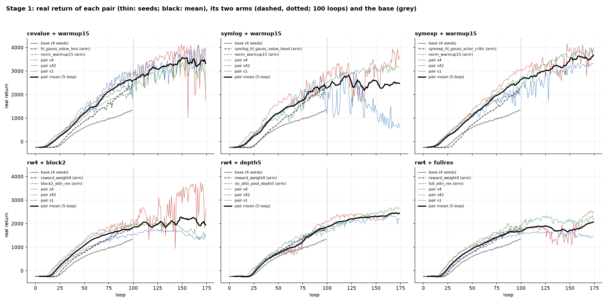
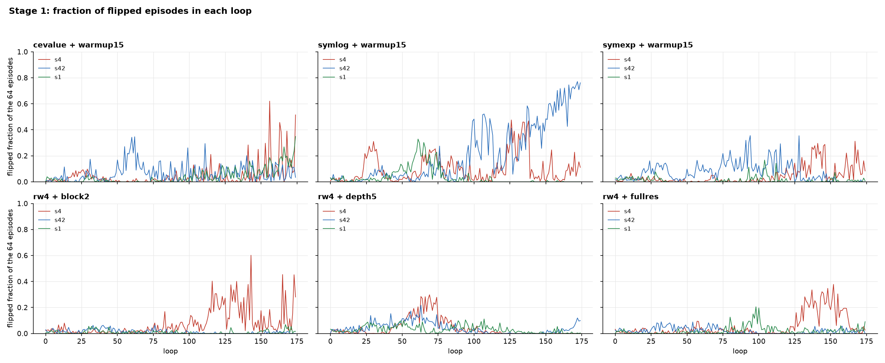
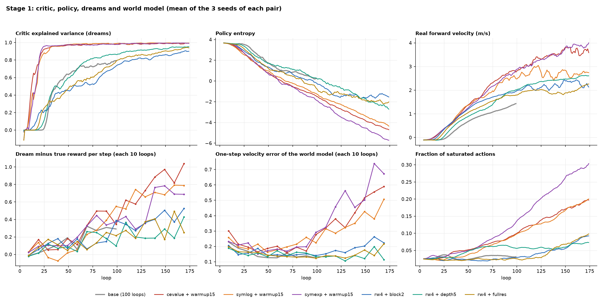

# Stage 1 of the combinations: 18 runs of two arms each

Date: 2026-10-04. Queue: `scripts/queue_10-3-26c.sh`, record `runs/queues/10-3-26c_2026-10-03_194348`. Entries 118-135 of `train/ablations.py`. The selection of the arms and the stage-2 choice are in `report/10-3-26-combinations/REPORT.md`.

## 1. Summary

- All 18 runs ended with exit 0. Each run was 175 loops and took 50-63 minutes, with two runs on the GPU at a time.
- **All six pairs are above the base.** At loops 95-99 and over loops 0-99, each pair is above the base with p < 0.04.
- **The three value + warmup15 pairs are the fastest group.** At loops 150-174 they give 3,569 (symexp), 3,377 (cevalue) and 2,423 (symlog). The three rw4 + attention pairs give 1,899 to 2,385.
- **symexp + warmup15 is the best pair.** It is the only pair above both of its arms with p < 0.04 (loops 95-99). It has the highest return at loops 170-174 (3,680) and ends 42 below its best 5-loop mean. Its three seeds end at 3,829, 3,290 and 3,921.
- **The fast pairs are less stable after loop 100, because more episodes flip.** One flip event in one loop can drop the return of that loop by up to 3,009. The return then comes back in the next loop.
- **symlog + warmup15 seed 42 slowly goes into the flipped gait.** Its flipped fraction rises from 0.10 at loop 120 to 0.76 at loop 174, and its return falls from about 2,700 to 594. This is the flipped-gait collapse of the earlier runs.
- **The dreams of the fast pairs become more optimistic as the policy gets faster.**
  - At loops 150-174, the dream reward is above the true reward by 0.69 to 0.93 for each step. For the rw4 pairs it is 0.31 to 0.45.
  - The one-step velocity error of the world model rises from 0.20 to 0.44-0.71.
  - The policy moves into fast states, where the replay has few data.
- **rw4 + depth5 had no flip events and the best world model.**
  - Its relative noise after loop 100 is 1.9-2.7 %, none of its loops falls by more than 15 %, and it has no loop with more than 20 % flipped.
  - Its world model is the most accurate (action ranking rho 0.55; the pairs differ with p 0.017).
  - It is slower, and its return still rises at loop 174.
  - Section 7 shows that its smooth runs can be chance: with 3 seeds, the stability measures do not separate the pairs.
- **Settings or chance (section 7).** The settings determine the return and the flip risk. With 3 seeds, they do not determine which runs have flip events. The stability differences between pairs are not larger than the differences between the seeds of one pair.

## 2. Runs and method

| Pair | Arms | Entries |
| --- | --- | --- |
| cevalue + warmup15 | `hl_gauss_value_loss` + `norm_warmup15` | 118-120 |
| rw4 + block2 | `reward_weight4` + `block2_attn_res` | 121-123 |
| symlog + warmup15 | `symlog_hl_gauss_value_head` + `norm_warmup15` | 124-126 |
| symexp + warmup15 | `symexp_hl_gauss_actor_critic` + `norm_warmup15` | 127-129 |
| rw4 + depth5 | `reward_weight4` + `no_attn_pool_depth5` | 130-132 |
| rw4 + fullres | `reward_weight4` + `full_attn_res` | 133-135 |

- Each run: the grouped-normalization base (entry 73) with the two arms.
  - Seeds 4, 42 and 1, 175 loops (`stop_after_loops`).
  - `num_loops` stays 500, so the schedules of loops 0-99 are the same as in the 100-loop runs of the arms.
  - One checkpoint and replay snapshot at loop 175.
- The arms and the base ran 100 loops. All comparisons with them use loops 0-99. Loops 100-174 have no reference run.
- Measures (the same as in the earlier reports):
  - "Loop at 0" and "loop at 1,000": the last loop of the first 5-loop window with a mean return at or above that value.
  - "Largest drop": the largest fall of the 5-loop mean below its earlier maximum.
  - "Relative noise": the standard deviation of the return about a 9-loop centered mean, divided by the mean return of loops 100-174.
  - "Flipped fraction": the fraction of the 64 episodes of a loop that end flipped.
- Scripts:
  - `scripts/extract.py` reads all 175 loops.
  - `scripts/windows.py` gives the window means in the tables below.
  - `scripts/plot.py` makes the figures.
  - `report/10-3-26-combinations/scripts/stage1.py` gives the tests.

## 3. Return

Mean of the 3 seeds of each pair, and of the arms and the base, by loop window:

| Group | Loops 0-49 | 50-99 | 100-174 | 150-174 |
| --- | --- | --- | --- | --- |
| cevalue + warmup15 | 340 | 2,071 | 3,196 | 3,377 |
| symlog + warmup15 | 355 | 1,870 | 2,477 | 2,423 |
| **symexp + warmup15** | 308 | 1,959 | **3,205** | **3,569** |
| rw4 + block2 | 303 | 1,565 | 2,033 | 2,094 |
| rw4 + depth5 | 113 | 1,326 | 2,242 | 2,385 |
| rw4 + fullres | 227 | 1,408 | 1,830 | 1,899 |
| base (4 seeds) | 5 | 967 | - | - |
| cevalue / symlog / symexp alone | 96 / 24 / −38 | 1,604 / 1,568 / 1,465 | - | - |
| warmup15 alone | 355 | 1,698 | - | - |
| rw4 / block2 / depth5 / fullres alone | 82 / 146 / 133 / 152 | 1,341 / 1,409 / 1,343 / 1,497 | - | - |

Tests against the arms (loops 0-99, pooled t test; from section 3 of the 10-3-26 report):

| Pair | Return, loops 95-99, against arm 1 / arm 2 | Mean return, loops 0-99, against arm 1 / arm 2 |
| --- | --- | --- |
| cevalue + warmup15 | +251 (p 0.18) / +533 (p 0.006) | +356 (p 0.003) / +179 (p 0.12) |
| symlog + warmup15 | +31 (p 0.87) / +259 (p 0.17) | +317 (p 0.008) / +86 (p 0.45) |
| symexp + warmup15 | **+439 (p 0.022) / +595 (p 0.002)** | +420 (p 0.001) / +107 (p 0.35) |
| rw4 + block2 | +60 (p 0.74) / −101 (p 0.59) | +223 (p 0.055) / +157 (p 0.17) |
| rw4 + depth5 | +97 (p 0.60) / +112 (p 0.55) | +8 (p 0.94) / −18 (p 0.87) |
| rw4 + fullres | −77 (p 0.68) / −153 (p 0.41) | +106 (p 0.35) / −7 (p 0.95) |

- warmup15 gives the early start of all value pairs. Their return over loops 0-49 is the same as warmup15 alone (308-355), and the value arms alone give −38 to 96. After loop 50, the value loss gives the steeper slope.
- In the value pairs the two effects add: at loops 50-99 the pairs are 172-373 above warmup15 alone and 302-494 above their value arm alone.
- In the rw4 pairs the effects do not add. The pairs are within ±225 of their arms at loops 50-99.

Each run:

| Pair | Seed | Return, loops 95-99 | Return, loops 170-174 | Best 5-loop mean | Mean, loops 0-174 | Loop at 0 | Loop at 1,000 | Largest drop | Loops with a drop over 200 | Largest flipped fraction | Flipped fraction, last 10 loops | Minutes |
| --- | --- | --- | --- | --- | --- | --- | --- | --- | --- | --- | --- | --- |
| cevalue + warmup15 | 4 | 2,855 | 3,355 | 3,826 | 2,170 | 17 | 45 | 840 | 16 | 0.62 | 0.16 | 59 |
| cevalue + warmup15 | 42 | 2,504 | 3,737 | 3,831 | 2,143 | 21 | 43 | 517 | 28 | 0.35 | 0.07 | 59 |
| cevalue + warmup15 | 1 | 2,307 | 2,878 | 3,420 | 1,863 | 20 | 51 | 542 | 17 | 0.35 | 0.20 | 59 |
| symlog + warmup15 | 4 | 2,670 | 3,568 | 3,670 | 1,981 | 16 | 40 | 1,308 | 28 | 0.48 | 0.11 | 61 |
| symlog + warmup15 | 42 | 1,826 | **672** | 2,545 | 1,295 | 20 | 46 | **1,881** | 32 | **0.77** | **0.70** | 61 |
| symlog + warmup15 | 1 | 2,349 | 3,183 | 3,183 | 1,816 | 22 | 53 | 153 | 4 | 0.33 | 0.00 | 61 |
| symexp + warmup15 | 4 | 3,008 | 3,829 | 3,956 | 2,167 | 19 | 46 | 551 | 18 | 0.31 | 0.13 | 63 |
| symexp + warmup15 | 42 | 2,266 | 3,290 | 3,290 | 1,776 | 19 | 50 | 274 | 13 | 0.36 | 0.00 | 62 |
| symexp + warmup15 | 1 | 2,580 | 3,921 | 3,921 | 2,120 | 19 | 48 | 151 | 6 | 0.17 | 0.01 | 63 |
| rw4 + block2 | 4 | 1,982 | 2,917 | 3,594 | 1,747 | 20 | 44 | 769 | 27 | 0.60 | 0.20 | 54 |
| rw4 + block2 | 42 | 1,528 | 1,416 | 1,727 | 1,107 | 24 | 57 | 347 | 0 | 0.06 | 0.00 | 52 |
| rw4 + block2 | 1 | 1,933 | 1,504 | 1,997 | 1,362 | 18 | 46 | 598 | 1 | 0.07 | 0.03 | 52 |
| rw4 + depth5 | 4 | 2,042 | 2,454 | 2,454 | 1,378 | 28 | 75 | 248 | 3 | 0.30 | 0.00 | 58 |
| rw4 + depth5 | 42 | 1,871 | 2,190 | 2,383 | 1,329 | 24 | 68 | 193 | 3 | 0.22 | 0.06 | 59 |
| rw4 + depth5 | 1 | 1,641 | 2,664 | 2,664 | 1,410 | 28 | 55 | 40 | 2 | 0.11 | 0.00 | 50 |
| rw4 + fullres | 4 | 1,729 | 2,495 | 2,495 | 1,250 | 23 | 49 | 582 | 11 | 0.38 | 0.02 | 57 |
| rw4 + fullres | 42 | 1,543 | 1,443 | 1,672 | 1,058 | 27 | 63 | 233 | 0 | 0.09 | 0.02 | 55 |
| rw4 + fullres | 1 | 1,758 | 2,265 | 2,299 | 1,447 | 21 | 49 | 272 | 6 | 0.21 | 0.04 | 55 |

## 4. Stability and flipped episodes

Loops 100-174 of each run:

| Pair | Seed | Relative noise | Loops with a drop over 15 % | Worst one-loop drop | Loops with more than 20 % flipped | Share of the return variance that the flipped fraction explains (r²) |
| --- | --- | --- | --- | --- | --- | --- |
| cevalue + warmup15 | 4 / 42 / 1 | 16.0 / 8.4 / 6.3 % | 11 / 9 / 5 | 3,009 / 1,016 / 649 | 9 / 2 / 3 | 0.61 / 0.47 / 0.02 |
| symlog + warmup15 | 4 / 42 / 1 | 10.2 / 27.3 / 2.1 % | 7 / 21 / 0 | 1,054 / 1,417 / 174 | 17 / 62 / 0 | 0.69 / 0.95 / 0.11 |
| symexp + warmup15 | 4 / 42 / 1 | 8.1 / 7.2 / 3.6 % | 6 / 4 / 1 | 1,102 / 1,049 / 512 | 11 / 6 / 0 | 0.26 / 0.87 / 0.34 |
| rw4 + block2 | 4 / 42 / 1 | 17.3 / 2.4 / 2.5 % | 17 / 0 / 0 | 1,971 / 152 / 246 | 23 / 0 / 0 | 0.65 / 0.23 / 0.44 |
| rw4 + depth5 | 4 / 42 / 1 | 1.9 / 2.6 / 2.7 % | 0 / 0 / 0 | 152 / 237 / 207 | 0 / 0 / 0 | 0.21 / 0.01 / 0.56 |
| rw4 + fullres | 4 / 42 / 1 | 8.5 / 3.2 / 3.2 % | 9 / 0 / 1 | 633 / 169 / 442 | 18 / 0 / 0 | 0.52 / 0.46 / 0.45 |

- **The late drops are flip events, not policy collapses.**
  - At loop 156 of cevalue + warmup15 seed 4, 62 % of the episodes flip, and the return of that loop is 1,000 (loop 155: 4,009).
  - At loop 157 the flipped fraction is 0.16 and the return is 3,332. At loop 158 it is 0.04 and 3,941.
  - In the noisy runs, the flipped fraction explains 47-95 % of the variance of the late return.
- **One run goes into the flipped gait and stays there: symlog + warmup15 seed 42.**
  - Its flipped fraction rises in steps: 0.10 at loop 120, 0.37 at loop 123, 0.58 at loop 137, 0.60 at loop 152, and 0.76 at loop 174.
  - The return falls from about 2,700 to 594.
  - No other run has a flipped fraction above 0.2 in its last 10 loops.
- **Seed 4 is the noisy seed in four of the six pairs.** These are cevalue + warmup15, symexp + warmup15, rw4 + block2 and rw4 + fullres. In symlog + warmup15, seed 42 is the noisiest.
  - In rw4 + block2, seed 4 has the highest return (2,917 at loops 170-174) and 23 loops with more than 20 % flipped.
  - Seeds 42 and 1 of that pair are smooth, but they stay at 1,400-1,700.
- **rw4 + depth5 has no flip events after loop 100.** All three seeds are smooth and still rise at loop 174.
- In loops 0-99, symlog + warmup15 is less stable than the base and than both of its arms (noise 130, largest drop 382, 7 loops with a drop over 200; p < 0.04). The other pairs do not differ from their arms.

## 5. Critic, policy and world model

Means of the 3 seeds:

| Measure | Window | cevalue + warmup15 | symlog + warmup15 | symexp + warmup15 | rw4 + block2 | rw4 + depth5 | rw4 + fullres | base (0-99) |
| --- | --- | --- | --- | --- | --- | --- | --- | --- |
| Critic explained variance | 50-99 | 0.980 | 0.985 | 0.976 | 0.582 | 0.793 | 0.635 | 0.737 |
| Critic explained variance | 150-174 | 0.989 | 0.994 | 0.993 | 0.881 | 0.947 | 0.923 | - |
| Policy entropy | 150-174 | −4.34 | −3.94 | −5.26 | −1.44 | −2.30 | −2.00 | 0.82 (50-99) |
| Real velocity (m/s) | 150-174 | 3.64 | 2.68 | 3.88 | 2.27 | 2.55 | 2.08 | 1.10 (50-99) |
| Saturated actions | 150-174 | 0.185 | 0.186 | 0.286 | 0.080 | 0.070 | 0.085 | 0.032 (50-99) |
| Dream minus true reward per step | 150-174 | +0.93 | +0.79 | +0.69 | +0.45 | +0.31 | +0.37 | +0.25 (50-99) |
| Episodes flipped at the end, true | 150-174 | 0.32 | 0.44 | 0.32 | 0.15 | 0.12 | 0.10 | 0.05 (50-99) |
| Episodes flipped at the end, dream | 150-174 | 0.06 | 0.10 | 0.03 | 0.04 | 0.04 | 0.03 | 0.04 (50-99) |
| One-step velocity error | 150-174 | 0.57 | 0.44 | 0.71 | 0.24 | 0.16 | 0.18 | 0.14 (50-99) |
| Action ranking (Spearman rho) | 150-174 | 0.35 | 0.34 | 0.42 | 0.42 | 0.55 | 0.43 | 0.44 (50-99) |
| Reward error on replay (MAE) | 150-174 | 0.319 | 0.335 | 0.319 | 0.314 | 0.324 | 0.310 | 0.377 (50-99) |
| Dream and true return correlation | 150-174 | 0.89 | 0.89 | 0.91 | 0.87 | 0.88 | 0.83 | 0.84 (50-99) |

The two "flipped at the end" rows come from closed-loop audit rollouts: the same actions in the dream and in the real environment.

- **Critic.** With a cross-entropy value loss, the critic reaches an explained variance of 0.95 by loops 24-33 (5-loop mean) and 0.98 by loops 54-83. With rw4 and the base MSE value loss, it reaches 0.88-0.95 only by loop 175. This is the main reason why the value pairs rise faster.
- **Policy.** The value pairs push the policy entropy down to −3.9 to −5.3, and 19-29 % of the actions are at the limit of the action range. The policy becomes near-deterministic and bang-bang, which is the fast gait of HalfCheetah.
  - symexp + warmup15 has the lowest entropy, the most saturated actions and the highest velocity (3.88 m/s).
  - The PPO approximate KL (0.038-0.041) and clip fraction (0.32-0.33) do not rise, so the updates stay in the trust region.
- **World model at high speed.** After loop 100, the one-step velocity error of the value pairs rises to 0.44-0.71, two to four times that of the rw4 pairs (0.16-0.24).
  - The dreams of the value pairs are optimistic by +0.69 to +0.93 reward for each step.
  - The policy moves into states that the replay holds few of. The reward error on replay does not show this (0.31-0.34 for all pairs), because the replay holds mostly older, slower data.
- **The flip blind spot is still present.** In the closed-loop audit, 32-44 % of the true rollouts of the value pairs end flipped, but only 3-10 % of the dreams do. The world model does not predict the flip, so the policy cannot learn to avoid it. This agrees with the earlier finding that the world models do not dream the upright-to-flipped transition.
- **rw4 + depth5 has the best world model** at the end: action ranking 0.55, one-step velocity error 0.16, smallest dream optimism (+0.31). Its depth-5 arm alone also had the best ranking (0.52). The deeper transformer with two time layers models the dynamics better, at the same parameter count.

## 6. Findings for each pair

- **symexp + warmup15.**
  - The best pair: the highest return at loops 150-174 (3,569) and at loops 170-174 (3,680 ± 341).
  - The only pair above both of its arms with p < 0.04.
  - It has the smallest gap between the best and the last 5-loop mean (42).
  - Its late noise comes from flip events of seeds 4 and 42 (worst one-loop drops of 1,102 and 1,049).
  - It has the highest velocity, the most saturated actions, and the largest one-step velocity error.
- **cevalue + warmup15.**
  - It reaches 1,000 first (loops 43-51) and is the best pair over loops 50-99 (2,071).
  - After loop 100 it rises more slowly than symexp + warmup15. Its late return has the most flip drops (worst 3,009), and it has the largest dream optimism (+0.93).
  - Seed 1 ends 542 below its best 5-loop mean.
- **symlog + warmup15.**
  - Seeds 4 and 1 are good (3,568 and 3,183).
  - Seed 42 goes into the flipped gait after loop 120 and ends at 672.
  - It has the most flipped episodes of all pairs in both the real rollouts and the audit.
- **rw4 + block2.**
  - It has the largest seed spread at loops 170-174: 2,917, 1,416 and 1,504.
  - Seed 4 rises to 3,594, with many flip events. Seeds 42 and 1 stop near 1,500-2,000 after loop 100 and fall a little.
  - The critic is the weakest of all pairs (explained variance 0.58 at loops 50-99).
- **rw4 + depth5.**
  - The slowest start (loop at 1,000: 55-75), but the smoothest runs and the best world model.
  - The return still rises at loop 174 (2,190-2,664).
  - It is not better than its arms at loops 0-99.
- **rw4 + fullres.**
  - Seed 42 stops near 1,600 after loop 100. Seed 4 has a dip with flips at loops 125-160 and then recovers to 2,495.
  - It is not better than its arms.

## 7. Settings or chance: what makes a run unstable?

`scripts/stability_causes.py` tests this. It uses 58 runs in loops 50-99 (the base, the arms and the pairs; PMPO is not included) and the 18 pair runs in loops 100-174, and writes `data/stability_runs.csv`.

For each measure, the script tests three causes:
- **The settings.** An ANOVA over the groups, and the intraclass correlation (ICC): the share of the variance between runs that the settings explain. An ICC of 0 means two runs with the same settings differ as much as two runs with different settings.
- **The seed.** An additive model of group + seed, with seeds 4, 42 and 1.
- **How aggressive the policy is.** Velocity, saturated actions and entropy, as covariates.

| Measure | Window | Settings: p (ICC) | Seed: p | Policy covariates: R² |
| --- | --- | --- | --- | --- |
| Mean return | 50-99 | < 0.0001 (0.67) | 0.21 | 1.00 |
| Mean return | 100-174 | 0.010 (0.58) | 0.061 | 1.00 |
| Relative noise | 50-99 | 0.46 (0.01) | 0.087 | 0.25 |
| Relative noise | 100-174 | 0.49 (−0.02) | 0.20 | 0.08 |
| Mean flipped fraction | 50-99 | 0.59 (−0.04) | 0.044 | 0.38 |
| Mean flipped fraction | 100-174 | 0.45 (0.01) | 0.41 | 0.18 |
| Loops with more than 20 % flipped | 100-174 | 0.40 (0.04) | 0.31 | 0.21 |
| Loops with a drop over 15 % | 100-174 | 0.39 (0.05) | 0.25 | 0.10 |

The settings change the mechanism measures, and these differences are significant (loops 100-174, 6 pairs; family = value pairs against rw4 pairs):

| Measure | Pairs: ANOVA p | Value pairs | rw4 pairs | Family p |
| --- | --- | --- | --- | --- |
| Policy entropy | 0.0001 | −3.41 | −1.39 | < 0.0001 |
| Saturated actions | < 0.0001 | 0.178 | 0.057 | < 0.0001 |
| Critic explained variance | 0.0005 | 0.990 | 0.880 | < 0.0001 |
| Dream minus true reward per step | 0.012 | +0.69 | +0.32 | 0.0003 |
| True rollouts that end flipped (audit) | 0.010 | 0.32 | 0.10 | 0.0003 |
| Dream rollouts that end flipped (audit) | 0.39 | 0.06 | 0.04 | 0.29 |
| One-step velocity error | 0.042 | 0.45 | 0.16 | 0.0008 |
| Action ranking (Spearman rho) | 0.017 | 0.35 | 0.48 | 0.003 |

Stability of the two families in loops 100-174 (Mann-Whitney):

| Measure | Value pairs | rw4 pairs | p |
| --- | --- | --- | --- |
| Loops with a drop over 15 %, mean (median) | 6.7 (4) | 2.0 (0) | 0.038 |
| Relative noise, mean (median) | 9.9 % (8.1 %) | 4.9 % (2.7 %) | 0.077 |
| Loops with more than 20 % flipped, mean (median) | 12.2 (6) | 4.6 (0) | 0.11 |

Interpretation:
1. **The settings set the flip risk.**
   - The value pairs make a near-deterministic policy that saturates its actions. Saturated actions are the best single predictor of flips (Spearman rho +0.52, p < 0.0001, over loops 50-99).
   - In the closed-loop audit, the actions of the value pairs flip the real cheetah in 32 % of the rollouts (rw4 pairs: 10 %). In the dreams of both families, only 4-6 % flip.
   - The value pairs drive the policy toward a fast, risky gait, and the world model does not show the risk.
2. **Chance decides which runs show the risk.**
   - In both windows, the settings explain 0-5 % of the variance of the stability measures (ICC about 0).
   - Inside one pair, the seeds differ more than the pairs do. rw4 + block2 seed 4 has 23 loops with more than 20 % flipped, and its seeds 42 and 1 have 0.
   - The seed itself is not a reliable cause: p 0.20-0.41 in loops 100-174, and 0.044 only for the mean flipped fraction of loops 50-99. Seed 1 had 0 flip loops in 5 of the 6 pairs, but a pattern of this size occurs by chance in about 1 of 5 such experiments.
3. **The "most stable pair" is not established.**
   - Half of the 18 runs had no loop with more than 20 % flipped. Then the probability that a given pair has three such seeds by chance is 0.10, and 0.62 of the 6 pairs are expected to have them.
   - rw4 + depth5 is that pair, so its smooth runs can be luck.
   - Its better world model (ranking and velocity error) is a real difference.
4. **Only the family difference reaches p < 0.04**, in one measure (loops with a drop over 15 %). The value pairs are faster and have more large drops. The pairs inside a family do not separate.

Consequences for the criteria:
- With 3 seeds, "more stable" and "less seed variance" cannot select between settings. The return and the mechanism measures can.
- To test a stability difference between two settings, use more seeds, or a measure with less noise than the count of flip events. One example is the flipped fraction of the closed-loop audit, which separates the families with p 0.0003.

## 8. Recommendations

1. **Stage 2 (in the queue): symexp + warmup15 + block2** (entries 136-138, `scripts/queue_10-4-26.sh`). The rule gives this choice: section 4 of the 10-3-26 report gives the reasons.
2. **The flip blind spot is now the main limit of the fast runs.** The policy gets faster than the data that the world model has seen, and the world model does not predict flips. Changes that put fast and flipped transitions into the world-model data, or that keep the critic from rewarding risky states, address this. The earlier flip-blind-spot analysis has the details.
3. **depth5 is a candidate for a later stage.**
   - Its world model is the most accurate, and its runs are the smoothest.
   - rw4 + depth5 did not pass the stage-1 test against its arms, so it is not in stage 2 under the current criteria.
   - A test of symexp + warmup15 + depth5 would show whether the better world model reduces the flip events of the fast pairs.
4. **Compare at 175 loops.**
   - The arms have no 175-loop runs, so the effects after loop 100 have no reference.
   - A 175-loop run of symexp + warmup15 is already in stage 1. It is the reference for stage 2 after loop 100.
5. **wm_pretrain640 is still to be tested** in a combination.

## 9. Limits

- Three seeds for each pair. Seed 4 had the flip events in four of the six pairs, so the stability numbers depend on one seed in each pair.
- The arms and the base have 100 loops. The tests use loops 0-99.
- The audit measures are taken each 10 loops (17 values for each run).
- All runs have the wrong first dream frame of the compiled short-sequence bug, the same for each run.
- The latents of these runs were deleted after the analysis (to free disk space). The runs cannot resume, and the replay snapshots cannot be used to retrain the world model without a new tokenizer pass.

## 10. Files

- `scripts/extract.py`: reads all 175 loops of the 18 runs, and copies the loops 0-99 of the arms and the base from the 10-3-26 report. Writes `data/loop_metrics.csv`, `data/episodes.csv`, `data/run_summary.csv` and `data/arm_summary.csv`.
- `scripts/windows.py`: the window means of section 3 and section 5. Writes `data/windows.csv`.
- `scripts/plot.py`: writes `figures/returns.png`, `figures/flipped.png` and `figures/diagnostics.png`.
- `scripts/stability_causes.py`: the tests of section 7. Writes `data/stability_runs.csv`.
- `report/10-3-26-combinations/scripts/stage1.py`: the tests against the arms and the base.
